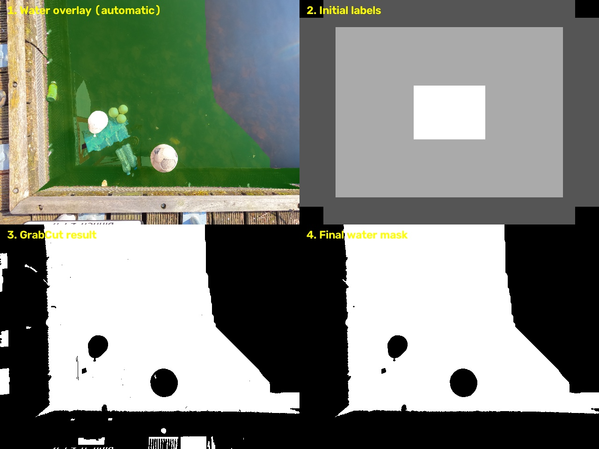
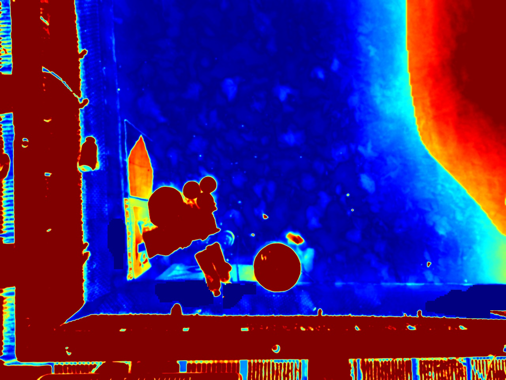
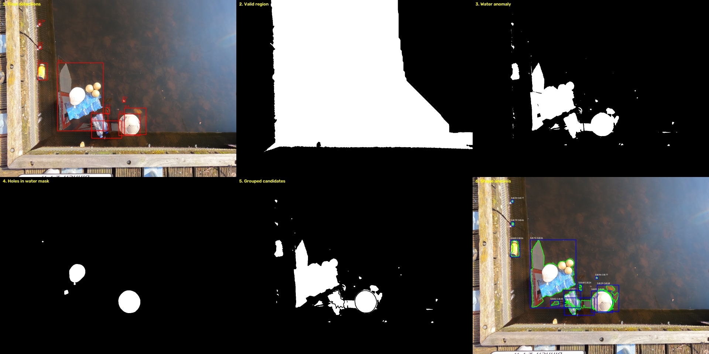

# Floating Litter Detector

**A classical computer-vision baseline for detecting, locating, and counting floating litter on water surfaces using Python and OpenCV — without neural-network training.**

<p align="center">
  <em>An interpretable and reproducible starting point for aquatic litter detection.</em>
</p>

---

## 1. Overview

An aquatic robot designed to collect floating litter from rivers, lakes, or canals must first be able to identify objects on the water surface.

However, detecting litter in aquatic environments is a challenging computer-vision problem. Unlike conventional object detection scenarios, the background is constantly changing due to reflections, ripples, sunlight, vegetation, and other environmental factors.

Floating litter also varies considerably in appearance. A plastic bag, a bottle, a food wrapper, and a small plastic fragment may have completely different shapes, colors, and dimensions.

This project explores a solution to that problem using **classical image processing techniques**, without relying on deep learning or neural-network training.

The current implementation uses:

- HSV color-space segmentation (baseline method).
- Water-region segmentation using manual polygons and GrabCut.
- LAB color-space analysis.
- Local background estimation and anomaly detection.
- Morphological image processing.
- Contour detection and geometric filtering.
- Distance-transform watershed for separating touching objects.
- Bounding-box generation and grouping.
- Ground-truth comparison using Intersection over Union (IoU).
- Precision, recall, and detection error analysis.

The objective is not to deliver a production-ready detector, but to establish a working and measurable baseline that can be progressively improved.

The project is designed to make both successful detections and failure cases observable, providing a foundation for future improvements in aquatic robotic perception.

## 2. Current Approach

The detector processes individual images and attempts to identify candidate litter regions based on their relationship with the surrounding water and their geometric properties.

Two detection methods are currently available:

- **Anomaly detection:** estimates the local appearance of water and identifies regions that deviate from it.
- **Color-based detection:** uses fixed HSV thresholds to identify bright, relatively unsaturated regions.

The anomaly-based method is the current primary approach, while the original HSV implementation is maintained as a baseline for comparison.

### 2.1. Image preprocessing and HSV segmentation (baseline)

The original detection method converts the input image from BGR to HSV color space.

HSV separates color information from brightness, making it possible to isolate bright and relatively unsaturated regions.

The original segmentation thresholds are:

| Channel | Threshold | Purpose |
|---|---|---|
| V (Value) | ≥ 180 | Select bright regions |
| S (Saturation) | ≤ 60 | Select low-saturation regions |

The resulting binary mask highlights pixels that satisfy both conditions.

This approach is intended to identify pale litter against darker water.

However, reflections and glare can exhibit similar color characteristics, making them difficult to distinguish using color information alone.

This method remains available through `detect_boxes(img, method="color")`.

### 2.2. Morphological processing

After segmentation, the binary mask is processed using morphological operations.

A 5×5 elliptical kernel is used for both operations:

- **Opening:** removes small isolated regions and noise.
- **Closing:** fills small gaps and connects nearby regions.

These operations help produce cleaner regions before contour extraction.

An important limitation is that morphological operations can also erase small litter fragments or merge nearby objects.

### 2.3. Contour detection and geometric filtering

The processed mask is passed to OpenCV's contour detection functionality.

Each extracted contour represents a candidate region that may correspond to floating litter.

To reduce obvious false detections, the algorithm applies several geometric filters:

| Filter | Current threshold | Purpose |
|---|---|---|
| Minimum area | 100 px² | Remove small noise |
| Maximum area | 10% of image area | Reject excessively large regions |
| Aspect ratio | ≤ 4 | Reject excessively elongated regions |
| Image borders | Must not touch the border | Reject border-related structures and glare |

The remaining contours are converted into bounding boxes.

These thresholds are configurable through the detection function, allowing experimentation without rewriting the pipeline.

### 2.4. Bounding-box generation and merging

Each accepted contour is converted into a bounding box:

`[x, y, w, h]`

Where:

- `x`: horizontal coordinate.
- `y`: vertical coordinate.
- `w`: bounding-box width.
- `h`: bounding-box height.

The implementation includes bounding-box grouping and merging to reduce duplicated detections when a single object is fragmented by segmentation gaps.

However, reflections and irregular object boundaries can still generate multiple partially overlapping or disconnected contours.

As a result, the same physical object may still receive two or more bounding boxes.

Improving object grouping remains an important development objective.

### 2.5. Ground-truth evaluation

The detector is evaluated against manually annotated ground-truth bounding boxes provided by the dataset.

The evaluation module calculates Intersection over Union (IoU) between predicted and annotated boxes.

IoU measures the overlap between two bounding boxes:

\[
IoU = \frac{|B_{pred} \cap B_{gt}|}{|B_{pred} \cup B_{gt}|}
\]

A detection is considered a match when:

\[
IoU \geq 0.5
\]

Each ground-truth object can be matched to at most one prediction.

The evaluation produces three main counts:

- **True Positives (TP):** correctly detected litter objects.
- **False Positives (FP):** detections that do not correspond to an annotated object.
- **False Negatives (FN):** annotated objects that were not detected.

From these values, the following metrics are calculated:

**Precision**

\[
Precision = \frac{TP}{TP+FP}
\]

Measures how many predicted detections are correct.

**Recall**

\[
Recall = \frac{TP}{TP+FN}
\]

Measures how many annotated litter objects were successfully detected.

These metrics provide a quantitative way to evaluate improvements instead of relying exclusively on visual inspection.

### 2.6. Water segmentation and water-relative litter detection

Detecting litter with fixed color rules is difficult on water surfaces. The water itself can be saturated (blue, green, or brown) and changes appearance due to sky reflections, ripples, and lighting conditions.

The pipeline therefore works in two stages:

1. Identify the region occupied by water.
2. Detect objects that differ from the expected appearance of that water.

This allows the detector to evaluate litter relative to its local environment instead of relying exclusively on fixed color thresholds.

#### 2.6.1. Water segmentation (`src/water.py`)

Water is segmented either from a manually drawn polygon or automatically using GrabCut.

**Manual polygon segmentation**

A polygon defines the valid aquatic region. Pixels inside the polygon are considered part of the water region, while pixels outside it are excluded.

This approach provides direct control over the segmentation and is particularly useful for difficult scenes.

**Automatic segmentation with GrabCut**

In automatic mode, the central region is assumed to contain water. Image corners that differ most in color from the center are used as background seeds.

The initial GrabCut result is subsequently cleaned using morphological closing and connected-component analysis, retaining the largest connected region.



*Panels: (1) water overlay, (2) initial GrabCut labels, (3) raw GrabCut result, (4) final water mask. The ball and the white object appear as black holes inside the water mask, which is a useful litter cue.*

The automatic segmentation is heuristic and must be inspected visually. For difficult scenes, manual polygons can be supplied through `WATER_POLYGONS` in `run_batch.py`.

#### 2.6.2. Litter as deviation from the local water color (`method="anomaly"`)

Inside the water region, `detect_boxes` estimates the expected water color locally using normalized Gaussian blur over valid water pixels only.

The algorithm then measures how far each pixel deviates from this estimated background in LAB color space.

Regions that differ significantly from their surrounding water become potential litter candidates. Holes in the water mask are also considered potential objects.



*Distance map (blue = close to the water color, red = far). The ball, the white object and the bags stand out clearly, while the water texture stays low. The dock and the area outside the water are also red, but they are excluded by the water mask.*

Additional safeguards:

- **Iterative background estimate:** anomalous pixels are excluded and the background is recomputed, preventing litter from contaminating its own background estimate.
- **Robust threshold:** median + k·MAD of the distances over the water (`anomaly_k`, with a floor of `anomaly_min_dist`).
- **Shadow handling:** pixels darker than the water weigh less, and very dark bands (shade over the water) are ignored.
- **Edge margin:** anomalies near the water boundary (dock shadows, ripples) are discarded; holes are always kept.
- **Shape filtering:** area, aspect ratio (including the rotated bounding rectangle, which rejects thin slanted strips), extent, and solidity.
- **Splitting touching objects:** non-convex blobs are separated using a distance-transform watershed.

The original absolute-color method remains available through:

```python
detect_boxes(img, method="color")
```

The anomaly-based method can be selected through:

```python
detect_boxes(img, method="anomaly")
```



*Diagnostic dashboard: (1) final detections, (2) valid water region, (3) water anomaly mask, (4) holes in the water mask, (5) grouped candidates, (6) contour and shape analysis.*

**Known limitations:** touching objects can still be reported as a single box (the litter cluster in the example), small ripples and leaves can produce small false positives, and litter touching the water edge is difficult to detect because segmentation may leave it outside the water region.

---

## 3. Project Architecture

The project is organized into independent modules, separating image loading, water segmentation, detection, evaluation, visualization, and batch execution.

```text
floating-litter-detector/
│
├── src/
│   ├── dataset.py       # Image and YOLO-label loading
│   ├── water.py         # Water-region segmentation and mask processing
│   ├── detect.py        # Color-based and anomaly detection pipelines
│   ├── evaluate.py      # IoU and detection evaluation
│   └── visualize.py     # Ground-truth and detection visualization
│
├── data/
│   └── raw/
│       ├── images/      # Dataset images
│       └── labels/      # YOLO-format annotations
│
├── docs/
│   └── images/          # Documentation and diagnostic images
│
├── results/
│   └── batch/           # Generated evaluation images
│
├── run_batch.py         # Batch evaluation entry point
├── .gitignore
├── requirements.txt
└── README.md
```

### Module responsibilities

| Module | Status | Responsibility |
|---|---|---|
| `src/dataset.py` | Ready | Loads images and YOLO-format annotations. Validated against the dataset to ensure ground-truth boxes align with the corresponding litter. |
| `src/water.py` | Ready | Implements manual polygon segmentation, automatic GrabCut segmentation, mask cleaning, and water-region visualization. |
| `src/detect.py` | Ready | Implements HSV color detection, LAB anomaly detection, local background estimation, geometric filtering, candidate grouping, and watershed-based object separation. |
| `src/evaluate.py` | Ready | Loads YOLO annotations, calculates IoU, matches predictions, and produces TP/FP/FN counts. |
| `src/visualize.py` | Ready | Draws ground-truth boxes in green and predicted boxes in red. |
| `run_batch.py` | Ready | Coordinates water segmentation, detection, batch evaluation, and generation of diagnostic outputs. |

### Detection interface

The main detection function is:

```python
detect_boxes(img, method="anomaly")
```

It receives an image and returns a list of bounding boxes:

```python
[
    [x, y, w, h],
    [x, y, w, h],
]
```

The `method` argument selects the detection approach:

- `"anomaly"`: water-relative anomaly detection.
- `"color"`: original HSV-based detection.

Detection thresholds are exposed as function arguments, allowing parameter tuning without modifying the underlying processing pipeline.

### Execution flow

```text
data/raw/images/*.jpg
          |
          v
      run_batch.py
          |
          v
       water.py
          |
          v
   Water segmentation
          |
          v
       detect.py
          |
          v
     detect_boxes()
          |
          v
 Predicted bounding boxes
          |
          +----------------------+
          |                      |
          v                      v
     evaluate.py            visualize.py
          |                      |
          v                      v
     TP / FP / FN         Comparison images
          |                      |
          v                      v
 Precision / Recall        results/batch/
```

The ground-truth annotations are loaded independently from:

```text
data/raw/labels/*.txt
```

The `run_batch.py` script orchestrates the complete workflow, while the individual modules can also be imported independently.

---

## 4. Installation and Usage

### Requirements

- Python 3.10 or newer.
- OpenCV.
- NumPy.
- Matplotlib.

### 4.1. Clone the repository

```bash
git clone https://github.com/caueSordi/floating-litter-detector.git
cd floating-litter-detector
```

### 4.2. Create a virtual environment

```bash
python -m venv .venv
source .venv/bin/activate
```

On Windows:

```powershell
.venv\Scripts\activate
```

### 4.3. Install dependencies

```bash
pip install opencv-python numpy matplotlib
```

Alternatively, install from the project's requirements file:

```bash
pip install -r requirements.txt
```

### 4.4. Download the dataset

Download the dataset from Zenodo:

[Amsterdam Dataset for Floating Litter Detection v2.0](https://zenodo.org/records/23674523)

Extract the images and annotations into the following directories:

```text
data/raw/
├── images/
│   ├── image_001.jpg
│   ├── image_002.jpg
│   └── ...
│
└── labels/
    ├── image_001.txt
    ├── image_002.txt
    └── ...
```

Image and annotation filenames must correspond.

### 4.5. Run the batch evaluation

From the project root:

```bash
python run_batch.py
```

The script:

1. Iterates through the images in `data/raw/images/`.
2. Resizes each image to 1280 pixels in width.
3. Executes the water segmentation pipeline.
4. Executes the selected detection pipeline.
5. Loads the corresponding YOLO annotations.
6. Matches predictions against ground truth using IoU.
7. Calculates TP, FP, and FN.
8. Saves comparison and diagnostic images in `results/batch/`.
9. Prints per-image and aggregated evaluation metrics.

---

## 5. Current Results

**Status: Baseline under evaluation.**

The implementation and batch evaluation pipeline are ready to run.

The initial evaluation uses all 92 images from the dataset. Final precision and recall values will be added after the complete evaluation has been executed.

| Metric | Result |
|---|---|
| Dataset images | 92 |
| Ground-truth annotations | 1,071 |
| Detection threshold | IoU ≥ 0.5 |
| Precision | Pending |
| Recall | Pending |
| True Positives | Pending |
| False Positives | Pending |
| False Negatives | Pending |

Results are reproducible by running:

```bash
python run_batch.py
```

Visual inspection is also performed using generated comparison images:

- Green bounding boxes: ground-truth annotations.
- Red bounding boxes: predicted detections.

---

## 6. Known Issues and Limitations

The current implementation has several documented limitations.

These are not hidden implementation details; they represent the main challenges that future iterations aim to address.

### 6.1. Water reflections detected as litter

**Problem:** Bright reflections from buildings, trees, and the sky can satisfy the same HSV thresholds used to identify pale litter.

Since the original color-based detector relies primarily on brightness and saturation, these regions can generate false positives.

The anomaly-based approach attempts to reduce this problem by estimating the local water appearance, but reflections and irregular lighting can still produce anomalous regions.

**Current impact:**

- Increased false-positive count.
- Duplicate detections.
- Incorrect litter counts.
- Reduced precision.

### 6.2. Multiple bounding boxes around a single object

**Problem:** A single piece of litter can produce multiple contours due to reflections, irregular surfaces, dark folds, and discontinuities in the binary mask.

The current grouping strategy does not always merge partially overlapping or disconnected detections.

**Current impact:**

- One physical object may be counted multiple times.
- Bounding boxes may represent only fragments of an object.
- Detection counts become less reliable.

### 6.3. Non-litter objects detected as litter

**Problem:** The algorithm does not understand the semantic identity of detected objects.

Foam, animals, vegetation, and other objects may satisfy the segmentation and geometric filters.

Since the system has no explicit object classification mechanism, these regions can be incorrectly reported as litter.

### 6.4. Large environmental structures and reflection regions

**Problem:** Large reflections from buildings, trees, and other structures may cover considerable portions of the water surface.

The maximum-area filter rejects some excessively large contours, but it does not identify the actual environmental source of a reflection.

Smaller fragments inside these reflection regions can still pass the detection filters and generate bounding boxes.

**Current impact:**

- False positives concentrated around large reflection regions.
- Multiple detections caused by a single environmental structure.
- Unreliable object counts.

A more robust approach will require identifying and suppressing unreliable regions before individual litter candidates are evaluated.

### 6.5. Litter with water-like colors is missed

**Problem:** Litter whose appearance is similar to the surrounding water may not produce sufficient color deviation to pass the anomaly threshold.

This represents a systematic false-negative problem.

### 6.6. Small objects are lost during processing

**Problem:** Some of the smallest annotated litter fragments are approximately 48 pixels wide in the original images.

After resizing to 1280 pixels in width, these objects may become approximately 11 pixels wide.

The minimum-area filter and morphological operations can remove such small regions entirely.

**Current impact:**

- Increased false negatives.
- Reduced recall.
- Poor detection of small plastic fragments.

---

## 7. Future Work and Development Roadmap

Future development will focus on improving detection reliability while maintaining an interpretable classical computer-vision approach.

The roadmap is organized around the limitations observed in the current implementation.

### Phase 1 — Evaluation and reproducibility

**Goal:** Establish a reliable evaluation procedure before changing the detection algorithm.

Planned improvements:

- [ ] Split the dataset into training/tuning and validation subsets (80/20), separated by image.
- [ ] Ensure that threshold tuning is performed only on the training/tuning subset.
- [ ] Evaluate final parameters on the untouched validation subset.
- [ ] Record baseline precision and recall.
- [ ] Export per-image TP, FP, FN, precision, and recall to CSV or JSON.
- [ ] Add a mean absolute error (MAE) metric for object counting.
- [ ] Compare the original HSV method against the anomaly-based method.

The validation split is particularly important because repeatedly tuning parameters against all 92 images could produce misleading results.

### Phase 2 — Object grouping and shape analysis

**Goal:** Identify when multiple detected regions belong to the same physical piece of litter and generate a single bounding box for that object.

This phase directly addresses the duplicate-detection problem.

Planned improvements:

- [ ] Analyze contour geometry and spatial relationships between nearby detections.
- [ ] Investigate contour continuity and edge information to identify fragmented object boundaries.
- [ ] Use connected-component analysis to investigate fragmented segmentation regions.
- [ ] Explore morphological reconstruction and more selective closing operations.
- [ ] Implement a more robust bounding-box grouping algorithm.
- [ ] Evaluate whether contour-based grouping or a clustering approach produces better results.
- [ ] Ensure that multiple fragments belonging to one object result in a single bounding box whenever appropriate.

Potential techniques include:

- Connected-component analysis.
- Contour hierarchy.
- Convex hull analysis.
- Shape descriptors.
- Distance-based clustering.
- Edge continuity analysis.

The objective is not simply to merge every nearby detection. Two separate pieces of litter may be close to each other, and merging them would introduce another detection error.

The grouping strategy must balance duplicate suppression with the ability to distinguish neighboring objects.

### Phase 3 — Reflection and environmental structure suppression

**Goal:** Identify large reflection regions and prevent objects inside those regions from being incorrectly classified as litter.

This phase addresses one of the largest sources of false positives in the current implementation.

Planned improvements:

- [ ] Investigate large-area contour detection as a preliminary reflection indicator.
- [ ] Analyze spatial distribution and texture patterns of reflection regions.
- [ ] Explore edge density and Sobel gradients to distinguish environmental structures from individual litter objects.
- [ ] Investigate adaptive glare and reflection masks.
- [ ] Implement region-based suppression for areas identified as unreliable.
- [ ] Test whether suppression improves precision without significantly reducing recall.

An important consideration is that not every large region should automatically be discarded.

Large pieces of litter can exist, and reflections may occupy only part of the image.

The objective is to identify unreliable environmental regions rather than blindly reject every large contour.

### Phase 4 — Improved segmentation and small-object detection

**Goal:** Reduce missed detections caused by color similarity and image resolution.

Planned improvements:

- [ ] Experiment with CLAHE for local contrast enhancement.
- [ ] Investigate adaptive HSV thresholds.
- [ ] Combine color segmentation with edge information.
- [ ] Experiment with Sobel edge detection.
- [ ] Test alternative morphological kernel sizes and shapes.
- [ ] Increase processing resolution from 1280 to 1920 pixels.
- [ ] Explore image tiling to preserve small-object details.
- [ ] Evaluate the impact of each change on precision and recall.

### Phase 5 — Video processing and temporal tracking

**Goal:** Extend the detector from isolated images to continuous video streams.

The current dataset contains still images, so temporal tracking cannot yet be properly evaluated.

Planned improvements:

- [ ] Add video input support using OpenCV.
- [ ] Implement centroid-based object tracking.
- [ ] Assign persistent IDs to detected objects.
- [ ] Associate detections across consecutive frames.
- [ ] Reduce duplicate counting caused by repeated observations of the same object.
- [ ] Investigate temporal consistency to distinguish moving litter from stationary reflections.

A lightweight tracking algorithm could provide a useful first step before introducing more complex tracking systems.

### Phase 6 — Quantitative analysis and demonstration

**Goal:** Make the detector easier to evaluate, compare, and demonstrate.

Planned improvements:

- [ ] Generate CSV and JSON evaluation reports.
- [ ] Calculate counting MAE.
- [ ] Generate visual comparisons between different detector configurations.
- [ ] Produce a demonstration video with bounding boxes and object IDs.
- [ ] Document performance changes between baseline and improved versions.

### Phase 7 — Learned object detection (long-term)

**Goal:** Investigate whether classical computer vision can be complemented or replaced by a learned detector.

Potential directions:

- Train or fine-tune an object detector such as YOLO.
- Investigate transfer learning with publicly available pretrained weights.
- Expand the dataset with additional aquatic environments.
- Compare classical and learned approaches using the same evaluation metrics.

The current dataset contains only 92 images and 1,071 annotations, which is a limited starting point for training a robust detector from scratch.

A learned approach is therefore considered a future research direction rather than a requirement for the current baseline.

---

## 8. Dataset

### Amsterdam Dataset for Floating Litter Detection v2.0

The project uses the **Amsterdam Dataset for Floating Litter Detection v2.0**, associated with TU Delft and the work of Jia et al.

Dataset source:

[https://zenodo.org/records/23674523](https://zenodo.org/records/23674523)

Dataset characteristics:

| Property | Description |
|---|---|
| Dataset | Amsterdam Floating Litter Detection v2.0 |
| Source | TU Delft / Jia et al. |
| Images | 92 |
| Annotated bounding boxes | 1,071 |
| Classes | 1 |
| Target class | Litter |
| Annotation format | YOLO |
| Environment | Amsterdam canals |

The dataset provides images of floating litter in real aquatic environments, together with bounding-box annotations.

It is particularly useful for this project because it exposes several of the difficulties associated with aquatic perception, including reflections, variable lighting, object fragmentation, and differences in litter appearance.

### Dataset availability

The dataset is not included in this repository.

The original image archive (`images.zip`) is approximately 567 MB.

Download the dataset directly from Zenodo and organize its contents according to the directory structure described in the installation section.

Please refer to the original dataset publication and its Zenodo record for attribution, licensing, and usage conditions.

---

## 9. Design Philosophy

This project follows three main principles:

**Interpretability**

Every detection should be traceable to an explicit image-processing operation or geometric condition.

**Reproducibility**

The same input image and configuration should produce reproducible detection results.

**Incremental development**

Each improvement should address an observed limitation and be evaluated against a documented baseline.

Rather than immediately introducing a neural network, this project explores how far classical computer vision can go when applied to a challenging real-world perception problem.

The intention is to understand the problem, establish measurable improvements, and build a foundation that can eventually be integrated into an aquatic robotic system.

---

## 10. Acknowledgements and Development Notes

This project used AI assistance (Muse) for documentation, brainstorming, and structural development.

The implementation was written from scratch for this project using Python and the public OpenCV API.

The project is intended as an experimental engineering and learning initiative focused on computer vision, environmental monitoring, and robotic perception.

---

## 11. License

**License: To be decided.**

A license will be selected before public distribution.

Dataset licensing and attribution requirements remain subject to the original Zenodo record and associated publication.

---